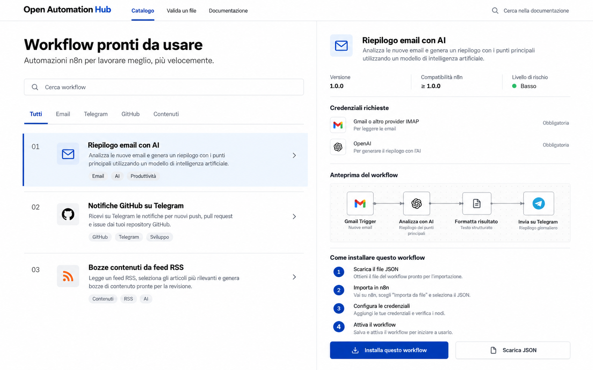

# OpenAutomationHub

Catalogo di workflow n8n con validazione locale, istruzioni per le credenziali e modelli scaricabili.



**Stato:** alfa locale utilizzabile. L'app web mostra due modelli n8n disattivati, permette di esaminare passaggi e rischi, scaricare il JSON e validare localmente un workflow caricato. Non esegue workflow e non conserva credenziali.

## Avvio locale

Richiede Node.js 24 o successivo.

```sh
npm ci
npm run dev
```

Apri l'indirizzo mostrato da Vite. Per una build di produzione, esegui `npm run build` e poi `npm run preview`.

## Verifiche

```sh
npm test
npm run validate:catalog
npm run build
```

Il validatore controlla struttura, nomi duplicati, riferimenti a nodi mancanti, credenziali associate, possibili segreti scritti nel JSON e manifest dichiarati. Gli avvisi segnalano alcuni nodi rischiosi: è una revisione statica, non una certificazione di sicurezza. Controlla JSON, destinatari, permessi e istanza n8n prima di importare o attivare un workflow.

## Modelli inclusi

- [Chat locale con Ollama](workflows/n8n/chat-ai-locale/README.md)
- [Release GitHub su Telegram](workflows/n8n/github-release-telegram/README.md)

I manifest seguono [lo schema versionato](schemas/workflow-manifest.schema.json). Per aggiungere un modello, consulta [il contratto dei workflow](docs/workflow-contract.md). L'alfa attuale copre n8n; Make e Node-RED sono obiettivi futuri.

## Licenza e supporto

Codice: [AGPL-3.0-only](LICENSE). Consulta [licenze e dipendenze](LICENSING.md), [segnalazioni di sicurezza](SECURITY.md) e [licenza commerciale](COMMERCIAL-LICENSE.md). I contributi seguono [la guida](CONTRIBUTING.md) e [il CLA](CLA.md).

Puoi sostenere lo sviluppo tramite [GitHub Sponsors](https://github.com/sponsors/MRJonam91), [Ko-fi](https://ko-fi.com/mrjonam), [Buy Me a Coffee](https://buymeacoffee.com/mrjonam) o [PayPal](https://paypal.me/manorollo).

English documentation: [README.md](README.md).
